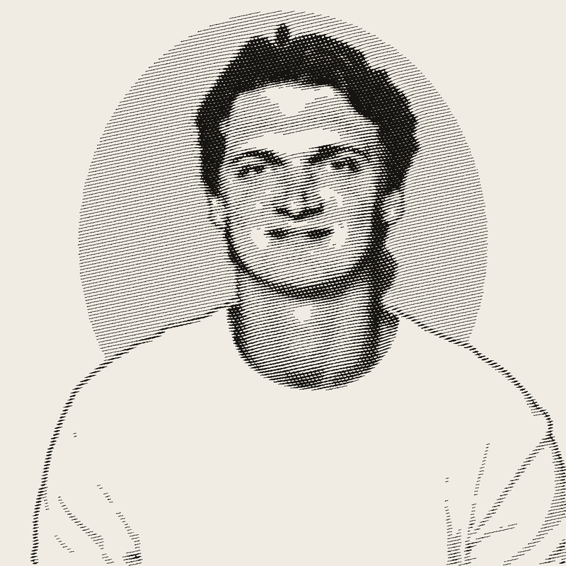

# Photo to ink etching

The script that turned my headshot into the portrait on [garetbuilds.com](https://garetbuilds.com/). It draws your photo as thousands of engraved lines, like the faces on paper money, and saves an SVG you can scale to any size.



## Run it (about 10 minutes the first time)

You need Python 3 (already on most Macs; check with `python3 --version`).

```bash
cd 05-photo-etching
python3 -m venv .venv
.venv/bin/pip install -r requirements.txt
.venv/bin/python etch.py your-photo.jpg -o etching.svg --png preview.png
```

## Get a good result
- Head and shoulders, facing the camera, against a **plain background** (one solid colour, no frame or border).
- The tool removes the background and puts a soft oval of fine lines behind you. Use `--keep-background` to etch everything, or `--no-halo` for no oval.
- `--spacing 2.6` gives darker, finer lines; `--spacing 4` is lighter and bolder.
- `--ink "#1a2a6c"` changes the line colour.
- `--size 900` gives more detail but runs slower.

## Use it on a website
The SVG is one shape, so you can colour it with CSS and it stays sharp at any size. To make it "print" onto the page from top to bottom:

```css
.etching {
  mask-image: linear-gradient(180deg, #000 0 45%, transparent 55% 100%);
  mask-size: 100% 220%;
  animation: print 2.2s ease-out both;
}
@keyframes print { from { mask-position: 0 100%; } to { mask-position: 0 0; } }
```
